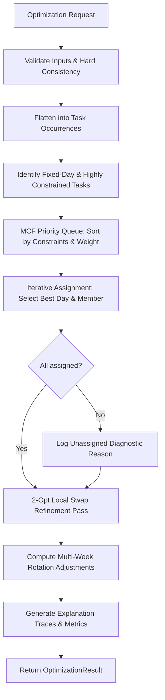

# ChoreMatrix — Phase 0 Implementation Plan: Deterministic Workload Optimizer

## Executive Summary & Product Alignment

ChoreMatrix is a **household workload optimization engine**, not a task checklist or gamified chore app. The core value thesis is:
> **Input → Optimization → Clear Output → Easy Adjustment**

This plan outlines the architecture, algorithm specification, and testing strategy for **Phase 0: Deterministic Household Workload Optimizer & Working Prototype**, reconciling all existing documentation (`00-project-brief.md` through `19-open-questions.md`).

---

## 1. Optimizer Inputs

The optimizer consumes a single, strongly-typed `OptimizationRequest` payload.

```typescript
export type DayOfWeek = 'mon' | 'tue' | 'wed' | 'thu' | 'fri' | 'sat' | 'sun';
export type HouseholdType = 'couple' | 'family' | 'roommates' | 'multigenerational' | 'custom';
export type OptimizationMode = 'balanced' | 'capacity_aware';

export interface HouseholdInput {
  id: string;
  name: string;
  type: HouseholdType;
  mode: OptimizationMode;
  planningHorizonWeeks: number; // 1 to 4
}

export interface MemberInput {
  id: string;
  name: string;
  role: string; // e.g., 'Adult', 'Teen', 'Child', 'Roommate'
  weeklyCapacityMinutes: number; // Total realistic capacity
  dailyCapacityMinutes?: Partial<Record<DayOfWeek, number>>; // Optional daily cap override
  unavailableDays?: DayOfWeek[]; // Days member cannot do any work
  preferredTaskIds?: string[]; // Soft preference (+affinity)
  avoidedTaskIds?: string[]; // Soft aversion (-affinity)
}

export interface TaskInput {
  id: string;
  name: string;
  category: string; // e.g., 'Kitchen', 'Cleaning', 'Laundry', 'Errands'
  frequencyPerWeek: number; // 1 to 14 occurrences per week
  durationMinutes: number; // Duration of single occurrence
  effortLevel: 1 | 2 | 3 | 4 | 5; // Physical/cognitive intensity (1 = light, 5 = grueling)
  eligibleMemberIds: string[]; // Hard constraint: only these members may do it
  excludedMemberIds?: string[]; // Hard constraint: explicit exclusions
  fixedDays?: DayOfWeek[]; // Hard constraint: must occur on these exact days
  preferredDays?: DayOfWeek[]; // Soft preference: preferred days for this task
  minSpacingDays?: number; // Soft preference: spacing between occurrences (default: 1)
}

export interface OptimizationRequest {
  household: HouseholdInput;
  members: MemberInput[];
  tasks: TaskInput[];
  previousRunAssignments?: AssignmentOutput[]; // For minimal-disruption rebalancing
  pinnedAssignmentIds?: string[]; // Assignments locked by user
}
```

---

## 2. Normalized Internal Representation

To ensure clean mathematical evaluation, inputs are pre-processed into normalized execution structures:

### 2.1 Occurrence Unit Decomposition
Every task is expanded across the planning horizon into discrete occurrence units:

$$\text{Total Occurrences} = \text{frequencyPerWeek} \times \text{planningHorizonWeeks}$$

For each occurrence $k \in [1, \text{Total Occurrences}]$:
- **`occurrenceId`**: `${task.id}_w${weekIndex}_o${k}`
- **`durationMinutes`**: Base time $T$
- **`effortMultiplier`**: Mapped from `effortLevel`:
  - Level 1 (Light): $1.00$
  - Level 2 (Moderate): $1.25$
  - Level 3 (Demanding): $1.50$
  - Level 4 (Heavy): $1.85$
  - Level 5 (Grueling): $2.25$
- **`weightedMinutes`**: $T \times \text{effortMultiplier}$
- **`candidateMembers`**: $\text{eligibleMemberIds} \setminus \text{excludedMemberIds}$

### 2.2 Household Capacity Matrix
- **`totalHouseholdCapacityMinutes`**: $\sum_{m} \text{weeklyCapacityMinutes}_m$
- **`totalHouseholdWorkMinutes`**: $\sum_{t} (\text{frequencyPerWeek}_t \times \text{durationMinutes}_t)$
- **`totalHouseholdWeightedWork`**: $\sum_{t} (\text{frequencyPerWeek}_t \times \text{weightedMinutes}_t)$
- **`targetUtilizationRatio`**: $\frac{\text{totalHouseholdWeightedWork}}{\text{totalHouseholdCapacityMinutes}}$

---

## 3. Assignment Algorithm

The Phase 0 optimizer uses a **Deterministic Greedy Heuristic with Most-Constrained-First (MCF) Priority Queue**, followed by a **Bounded 2-Opt Local Swap Refinement**.



### 3.1 Priority Ordering (MCF)
Occurrences are sorted in descending order of difficulty:
1. **Fixed Day Constraints**: Occurrences restricted to a specific day.
2. **Eligibility Degree**: Fewer candidate members = higher priority.
3. **Task Load**: Higher `weightedMinutes` assigned before small chores.
4. **Spacing Requirements**: Higher `minSpacingDays` scheduled first.
5. **Deterministic Tie-Breaker**: Lexicographical sort by `taskId` and `occurrenceIndex`.

### 3.2 Slot Evaluation
For each occurrence, all valid $(\text{day}, \text{member})$ pairs are evaluated.
- Candidate is filtered out immediately if any **Hard Constraint** is violated.
- Valid candidates are evaluated using the **Objective Function**.
- The candidate pair with the minimum objective score is chosen.

### 3.3 2-Opt Local Refinement
After initial greedy assignment:
1. Identify member with highest utilization and member with lowest utilization.
2. Search for valid single-task shifts or pairwise task swaps that decrease the global objective variance.
3. Apply swap only if improvement $> \epsilon$ and no hard constraints are breached.
4. Repeat for max 50 passes (guaranteed deterministic termination).

---

## 4. Scoring & Objective Function

Let candidate assignment for occurrence $u$ be member $m$ on day $d$. The assignment loss is:

$$\mathcal{L}(u, m, d) = \lambda_{\text{util}} \cdot \Delta \text{UtilCost} + \lambda_{\text{pref}} \cdot \text{PrefCost} + \lambda_{\text{day}} \cdot \text{DayCost} + \lambda_{\text{rot}} \cdot \text{RotCost} + \lambda_{\text{spike}} \cdot \text{SpikeCost}$$

### Components:

1. **Utilization Imbalance ($\Delta \text{UtilCost}$)**:
   - In **`capacity_aware`** mode:
     $$\text{UtilCost}_m = \left( \frac{\text{CurrentWeightedLoad}_m + \text{weightedMinutes}_u}{\text{Capacity}_m} - \text{targetUtilizationRatio} \right)^2$$
   - In **`balanced`** (equal workload) mode:
     $$\text{UtilCost}_m = \left( \text{CurrentWeightedLoad}_m + \text{weightedMinutes}_u - \text{meanLoad} \right)^2$$

2. **Preference Penalty ($\text{PrefCost}$)**:
   - If $t \in \text{avoidedTaskIds}_m$: $+50 \times \text{effortLevel}$
   - If $t \in \text{preferredTaskIds}_m$: $-30 \times \text{effortLevel}$

3. **Day Alignment ($\text{DayCost}$)**:
   - If task has `preferredDays` and $d \notin \text{preferredDays}$: $+25$
   - Violation of `minSpacingDays` from prior occurrence of same task: $+100$

4. **Rotation Bias ($\text{RotCost}$)**:
   - If $m$ performed this task in previous week $w-1$: $+40 \times \text{effortLevel}$

5. **Daily Spike ($\text{SpikeCost}$)**:
   - Penalty if day's total duration for member exceeds their daily capacity by $> 30\%$: $+60$

Weights: $\lambda_{\text{util}} = 1.0, \lambda_{\text{pref}} = 0.4, \lambda_{\text{day}} = 0.3, \lambda_{\text{rot}} = 0.5, \lambda_{\text{spike}} = 0.6$.

---

## 5. Hard vs. Soft Constraints

| Constraint | Type | Enforcement Mechanism | Failure Action |
| :--- | :--- | :--- | :--- |
| **Eligibility** | **HARD** | Member must be in `eligibleMemberIds` and not in `excludedMemberIds`. | Slot pruned immediately. If empty, task marked `UNASSIGNED`. |
| **Member Unavailable Day** | **HARD** | If member is away on day $d$, member cannot be assigned to day $d$. | Candidate $(\text{day}, m)$ discarded. |
| **Fixed Day Requirement** | **HARD** | Task occurrence must be scheduled on specified day $d$. | Day locked; only available members evaluated. |
| **Capacity Utilization** | **SOFT** | Keep member workload proportional to capacity. | Penalized quadratically in objective function. |
| **Avoided Tasks** | **SOFT** | Member dislikes task. | Soft penalty. Can be assigned if no better option exists. |
| **Preferred Tasks** | **SOFT** | Member prefers task. | Soft bonus. Assigned when feasible. |
| **Spacing & Cadence** | **SOFT** | Keep recurring tasks separated (e.g., Mon & Thu). | Spacing penalty in day selection. |
| **Multi-Week Rotation** | **SOFT** | Prevent same member getting difficult chores every week. | Historical repeat penalty applied across weeks. |

---

## 6. Scheduling Logic

Weekly calendar spans 7 days: `mon`, `tue`, `wed`, `thu`, `fri`, `sat`, `sun`.
1. **Daily Capacity Derivation**:
   - If explicit `dailyCapacityMinutes` provided, use exact value.
   - Otherwise, evenly distribute: $\text{dailyCap} = \frac{\text{weeklyCapacityMinutes}}{7}$.
2. **Occurrence Distribution**:
   - For frequency $F = 1$: Default to preferred day or weekend/midweek based on category.
   - For frequency $F = 2$: Spread by 3–4 days (e.g., Tue/Sat or Mon/Thu).
   - For frequency $F = 3$: Spread by 2–3 days (e.g., Mon/Wed/Fri or Tue/Thu/Sat).
   - For frequency $F = 7$: Scheduled daily (Mon through Sun).

---

## 7. Rotation Logic

Across multi-week horizons (1–4 weeks):
1. **State Preservation**: The optimizer maintains a multi-week ledger of cumulative assignments.
2. **Chore Dispersion**: For recurring heavy tasks (effort $\ge 3$, e.g., Bathroom deep clean, grocery run), the algorithm penalizes assigning the same member in consecutive weeks if other eligible members exist.
3. **Capacity Deficit Catch-up**: If a member ended Week 1 under-utilized due to indivisible chunk constraints, their baseline capacity in Week 2 is adjusted so monthly totals balance out.

---

## 8. Rebalance Logic

When a user adjusts constraints (e.g., "Arjun unavailable on Wednesday", "Maya capacity reduced by 60 min"):

### Differential Rebalancing Strategy:
1. **Lock Pinned Tasks**: Any task explicitly locked by the user is preserved verbatim.
2. **Invalidate Affected Assignments**: Identify assignments that now violate hard constraints (e.g., assigned person is now unavailable or ineligible).
3. **Churn Minimization**:
   - Maintain original assignments as "soft anchors".
   - Introduce a churn penalty $\mathcal{P}_{\text{churn}} = 20$ for moving an unaffected assignment from its previous owner.
4. **Targeted Re-optimization**: Re-assign invalidated tasks and rebalance overloaded members without scrambling the rest of the household.
5. **Diff Generation**: Produce an explicit explanation list:
   - e.g., *"Dishes moved from Arjun to Maya because Arjun is unavailable on Wednesday."*

---

## 9. Failure & Unsatisfiable Cases

The optimizer **never silently drops a task**. If hard constraints cannot be satisfied, the occurrence is appended to `unassignedTasks` with structured diagnostic reasons:

| Diagnostic Code | Meaning | Actionable User Remediation |
| :--- | :--- | :--- |
| `ERR_NO_ELIGIBLE_MEMBERS` | No members exist in the task's eligible list. | "Select at least one eligible household member." |
| `ERR_ALL_ELIGIBLE_UNAVAILABLE` | Task is fixed on day $d$, but all eligible members are unavailable on day $d$. | "Adjust member availability on that day or allow flexible scheduling." |
| `ERR_CAPACITY_DEFICIT` | Total household work exceeds 100% of household capacity. | "Household is overbooked by $X$ minutes. Increase capacity or reduce task frequencies." |
| `ERR_CONFLICTING_FIXED_SCHEDULE` | Member booked beyond 24h on a fixed day. | "Check conflicting fixed tasks on that day." |

---

## 10. Test Scenarios (Automated Test Suite)

| ID | Test Scenario | Expected Outcome |
| :--- | :--- | :--- |
| **TS-01** | **Equal Capacity Couple** (2 adults, 240 min each, identical tasks) | Workload split within 5% variance; balanced utilization. |
| **TS-02** | **Unequal Family** (Adult 300m, Teen 120m, Child 60m) | Utilization ratios equalized (~5:2:1 ratio of assigned load). |
| **TS-03** | **Strict Ineligibility** (Child cannot do 'Bathroom Deep Clean' or 'Stove Clean') | Child receives 0 heavy cleaning occurrences; only simple tasks. |
| **TS-04** | **Unavailable Day** (Member A travels on Tue & Wed) | Member A assigned 0 tasks on Tue/Wed. |
| **TS-05** | **Effort Weight Differentiation** (30m light vs 30m heavy) | Heavy task correctly accounts for weighted multiplier in balance. |
| **TS-06** | **Aversion & Preference** (Member A avoids dishes, Member B prefers dishes) | Dishes assigned to Member B when feasible. |
| **TS-07** | **Multi-Week Rotation** (Bathroom cleaning across 4 weeks with 2 eligible adults) | Chores alternate between adults; neither adult gets 4 weeks consecutively. |
| **TS-08** | **System Overload Flagging** (Total work 25h, total capacity 10h) | All feasible tasks assigned; deficit flagged clearly in summary without crash. |
| **TS-09** | **Zero Eligible Members** (Task created with no eligible members) | Task placed in `unassignedTasks` with `ERR_NO_ELIGIBLE_MEMBERS`. |
| **TS-10** | **Minimal Disruption Rebalance** (Member capacity altered mid-plan) | Valid assignments remain stable; only necessary tasks re-routed with explanation diff. |
| **TS-11** | **Deterministic Invariance** (Identical input payload executed 100 times) | Exactly identical assignment hashes on every single run. |

---

## 11. Prototype Acceptance Criteria (Definition of Done)

1. **Modular Architecture**:
   - Optimizer core implemented in pure, headless TypeScript (`src/optimizer/`).
   - Zero UI or DOM dependencies in the optimizer engine.
2. **Determinism**:
   - 100% identical outputs for identical inputs across all browsers and Node test runners.
3. **Comprehensive Test Suite**:
   - 11/11 automated unit test scenarios passing in Vitest/Node.
4. **Working Interactive Prototype**:
   - Browser prototype updated to use the new engine.
   - Live toggling of household presets, member capacities, and unavailable days.
   - Day-by-day calendar schedule view + weekly rotation view.
   - Real-time diagnostic breakdown (Capacity utilization, unassigned alerts, explainability tags).
   - Rebalance button with visual diff of what changed.

---

## 12. File & Directory Breakdown

```text
chorematrix/
├── src/
│   └── optimizer/
│       ├── types.ts              # Core domain models, inputs, outputs, diagnostic types
│       ├── weights.ts            # Effort multipliers, penalty constants, scoring weights
│       ├── normalizer.ts         # Occurrence generator, capacity matrix calculator
│       ├── evaluator.ts          # Hard constraint checker & soft objective scoring function
│       ├── scheduler.ts          # Day slotting & cadence/spacing logic
│       ├── rotation.ts           # Multi-week rotation state & streak penalties
│       ├── rebalancer.ts         # Differential rebalancer & change diff generator
│       ├── engine.ts             # Main deterministic entry point (MCF + 2-Opt)
│       └── index.ts              # Clean public export
├── tests/
│   └── optimizer/
│       ├── fixtures.ts           # Standard test household datasets
│       ├── engine.test.ts        # TS-01 through TS-11 test cases
│       └── rebalance.test.ts     # Differential stability & rebalance tests
├── index.html                    # Phase 0 interactive prototype wired to engine
└── package.json                  # Scripts: "test", "build", "dev"
```

---

## 13. Phase 0 Work Breakdown & Step-by-Step Execution Plan

- [ ] **Step 1: Module Scaffolding & Type Definitions**
  - Create `src/optimizer/types.ts` and `src/optimizer/weights.ts`.
  - Define all strict interfaces for inputs, occurrences, assignments, and diagnostics.
- [ ] **Step 2: Normalization & Pre-computation**
  - Implement `src/optimizer/normalizer.ts`.
  - Build occurrence expander and capacity matrix normalizer.
- [ ] **Step 3: Constraint Evaluator & Objective Function**
  - Implement `src/optimizer/evaluator.ts`.
  - Code hard constraint guards and parameterized loss function.
- [ ] **Step 4: Scheduling & Multi-Week Rotation**
  - Implement `src/optimizer/scheduler.ts` and `src/optimizer/rotation.ts`.
  - Handle spacing, calendar slotting, and multi-week streak tracking.
- [ ] **Step 5: Core Deterministic Optimizer Engine**
  - Implement `src/optimizer/engine.ts` with MCF priority queue and 2-opt refinement passes.
  - Implement explainability reason generator (`highest_remaining_capacity`, `avoided_task_penalty_tradeoff`, etc.).
- [ ] **Step 6: Differential Rebalancing Engine**
  - Implement `src/optimizer/rebalancer.ts` with churn minimization and diff reporting.
- [ ] **Step 7: Automated Test Suite Implementation**
  - Build `tests/optimizer/engine.test.ts` implementing TS-01 through TS-11.
  - Run and verify 100% passing tests.
- [ ] **Step 8: Prototype UI Integration**
  - Connect the modular engine into the interactive prototype `index.html`.
  - Add calendar schedule matrix, unassigned chore alerts, reason badges, and rebalance diffs.
- [ ] **Step 9: Validation & Acceptance Sign-off**
  - Verify all 11 prototype acceptance criteria.
